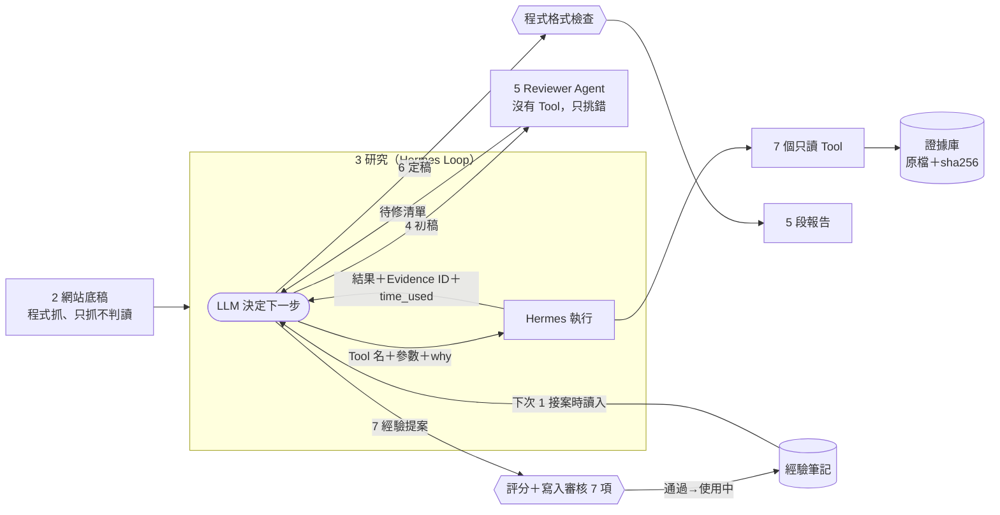

# 任務一：Hermes 自主 SEO 競爭情報 Agent

用 **Hermes** 建的 SEO 競爭情報 Agent。給它競爭者網址和關鍵字，它會自己決定查什麼、用哪個 Tool、怎麼驗證，最後交一份競爭分析與行動建議，每句結論都附 Evidence ID。每次研究走過的路線要先過審核，通過才會變成下一次的經驗。

- **Hermes 實跑**：`claude-sonnet-5-5` 研究 2030.tw，用了 27 次 Tool、1.31M Token、455 秒。Reviewer Agent 挑出 14 項，寫入 1 條經驗（EXP-001）。紀錄在 [`seq-r1-20261117-225453/`](reports/runs/seq-r1-20261117-225453/)
- **一個指令跑起來**：只需要網路，不用先裝 Python。CI 在 Linux、macOS、Windows 跑同一個指令
- **離線可驗證**：224 個測試，不連網、不叫模型。評分器先證明會抓錯，才拿來比較

> **授權**：本專案僅授權面試評估使用，禁止商業使用、整合或散布，詳見 [LICENSE](LICENSE)。

**目錄**

- [Demo Video](#demo-video)
- [1. 快速開始](#1-快速開始)
- [2. 系統怎麼運作](#2-系統怎麼運作)
- [3. 符合題目要求](#3-符合題目要求)
- [4. Harness 實驗結果](#4-harness-實驗結果)
- [5. 目前限制](#5-目前限制)
- [6. 若再有 4 週](#6-若再有-4-週優先改善什麼)
- [7. 常見問題](#7-常見問題)
- [題目原文](#題目原文)

---

## Demo Video

https://github.com/user-attachments/assets/e10504e5-d3d1-4c1f-b8d8-48559c4eb048

- 約 4 分鐘，內容是上面那次 Hermes 實跑，用 [`scripts/watch_run.py`](scripts/watch_run.py) 照實際紀錄以 2 倍速重播。播不出來時可下載 [`docs/demo/task1-hermes-demo.mp4`](docs/demo/task1-hermes-demo.mp4)
- 畫面順序依原題 Demo 要求：
  - 3 研究：Agent 自主研究，每個 Tool 一行，附為什麼這樣查（Tool Use）
  - 4 初稿 → 5 審查 → 6 定稿：每句結論都要有 Evidence ID 撐住（Evidence-based Decision）
  - 結尾：競爭分析與行動建議
  - 7 經驗：Memory / Learning
- 自己實跑同樣畫面：`scripts/live_demo.sh`（會花額度，輸出在 `reports/sequence/hermes-live/`）

---

## 1. 快速開始

在專案根目錄執行：

| 作業系統 | 指令 |
|---|---|
| macOS／Linux | `./start_task1.sh --test` |
| Windows（PowerShell） | `powershell -ExecutionPolicy Bypass -File .\start_task1.ps1 --test` |

過程中會問你：**要不要貼 Anthropic API key**。電腦裡沒有 uv 時，會先多問一次要不要安裝 uv。

- **直接按 Enter**：在終端機用 20 倍速重播上面那次 Hermes 實跑，不花額度
- **貼上 key**：用 Hermes 實際研究 2030.tw，約 10 分鐘，會花額度，只讀公開網頁。畫面會即時顯示每一步，輸出在 `t1-output/`；key 不會存檔
- 加 `--offline` 就不問 key；拿掉 `--test` 就跳過測試

第一次約 5 分鐘，多半在下載 Hermes；之後再跑，已完成的步驟會自動略過。

**跑完會看到**（重播的最後一段）：

```text
6 定稿  AI 依審查意見補查、改寫
  ✓ 查 sitemap  → 找到 0 筆  E-0139
    為什麼：確認 10 月底的文章是否在 sitemap（驗證 sitemap 是否漏掉 8 月後文章…
  ✗ 搜尋  「site:2030.tw 3a娛樂城」  → 被擋（人機驗證或非 200），不繞過，記成 …
  ✓ 定稿通過格式檢查
  審查 14 項 → 需人工判定 10、補查後修正 3、降成推論 1

7 經驗  AI 寫下這次的查法，給下一次參考
  ✗ 一條經驗格式不合被退回，AI 重寫
  + [照走] 競爭者網站的 sitemap 有一個佔比很大的單一資料夾，網址是關鍵字當 slu…
  寫入審核（程式，7 條規則）
  ✓ P1  通過 → EXP-001，下一輪開始就會讀到

行動建議（報告前 3 條）
  1. 先確認它有沒有成效再決定投入：用你自己的排名與外鏈工具（SERP、Ahrefs、Sem…
  2. 針對『娛樂城』與『3A娛樂城』做比它更深的專頁：涵蓋它那 6 個固定區塊與 FAQ…
  3. 規劃分類／主題頁承接品牌長尾詞：用它的分類（品牌、評價、優惠、遊戲玩法、 …

✓ 完成  07:34
```

一次 run 的主要輸出：

| 檔案 | 內容 |
|---|---|
| `report.md`／`report.json` | 5 段報告：摘要、On-page、Off-page、優先行動、未知與限制 |
| `evidence.jsonl`＋`raw/` | 每份證據的原檔與 sha256 |
| `tool_calls.jsonl` | 每次 Tool 呼叫，含選填的 `why` |
| `review.json` | Reviewer Agent 的待修清單 |
| `experience_proposals.jsonl`／`experience_audit.json` | 這次寫下的經驗／寫入審核結果 |

逐步手動命令、全部輸出檔、依序實驗與換執行者的用法：[`docs/usage.md`](docs/usage.md)。用詞對照：[`docs/glossary.md`](docs/glossary.md)。

---

## 2. 系統怎麼運作

**比喻：偵探接案**

- 助理先把公開資料整理成一張卡（第 2 步）
- 偵探自己決定先查什麼、查多深（第 3 步）；助理只報時，並提醒「哪些區還沒看過」
- 報告寫完，先給另一個人挑毛病（第 5 步），修好才交（第 6 步）
- 最後把「哪條路好走、哪條路別走」記進筆記本（第 7 步）
- 筆記要事後有人核過（評分＋寫入審核），下次才拿得到



完整架構圖（含 Skill、停止條件、評估、下架）：[`docs/architecture.md`](docs/architecture.md)。

**一次 run 的 7 步**（`cli run` 一條命令自動跑完）

| 步驟 | 誰做 | 做什麼 |
|---|---|---|
| 1 接案 | 程式 | 讀任務文字、Skill 與使用中經驗 |
| 2 網站底稿 | 程式 | 抓 robots、sitemap、Wayback、首頁選單、WHOIS 與兩個關鍵字搜尋；每個網站只建一次 |
| 3 研究 | LLM＋Hermes | 自己決定用哪個 Tool、查什麼，每次呼叫可附 `why` |
| 4 初稿 | LLM | `submit_report` 交初稿 |
| 5 審查 | Reviewer Agent | 沒有 Tool，只看報告與引用的證據，列待修清單 |
| 6 定稿 | LLM＋程式 | 依待修清單修一次（可先補查）；程式檢查 Evidence ID 存在、fact 有證據、inference 有 limits |
| 7 經驗 | LLM | 用 `experience` 寫下 0–3 條走過的路線 |

run 結束後，程式另外做：凍結 grader 評分 → 經驗下架判定 → 寫入審核。`sequence` 命令會依序自動跑完這三步，再開下一輪。

**設計重點**

1. **研究順序不寫死**：程式只給 Tool、規則和停止條件，查什麼、先查哪個都由 LLM 在 Hermes Loop 裡決定。早期把流程寫死的版本，盲審只拿 3/8（[`docs/ai-dev-log.md`](docs/ai-dev-log.md) 案例 3）
2. **只給事實，不規定怎麼想**：Sonnet 隔離實驗中，拿掉 Skill 流程規定的精簡版可信技術數 15.7，完整版 11.5（[`docs/experiments.md`](docs/experiments.md)）。程式只多給 `time_used`、`sections_not_yet_read`、`page_text`
3. **每次都一樣的偵察交給程式**：網站底稿省 Token、結果穩定；只抓不判讀，找矛盾交給 LLM
4. **怎麼算交給 Tool，不能錯的交給程式檢查**：數 sitemap、比對文字、查註冊日都做成 Tool；Evidence ID 與 fact 的證據由程式檢查
5. **每份資料都存原檔＋sha256**：報告只能引用真的拿到的 Evidence ID
6. **用 Reviewer Agent，不另加 Judge AI**：沒有 Tool、只挑錯的 Reviewer Agent 已經是另類的 Judge AI
7. **經驗只學路線，狀態只有使用中、已下架**：品質靠嚴格的寫入審核＋自動下架
8. **主分數＝可信 SEO 技術數**：凍結文字規則會被否定句、同義說法騙到，所以改由 Grader Agent 對證據核對；凍結 grader 留給經驗下架用，因為可重現、不花額度
9. **免費外部資料全用，付費資料標未知**：不偷用付費 API，也不猜排名與外鏈

**程式在哪**

| 想看 | 檔案 |
|---|---|
| Hermes 串接、每個 run 獨立的 `HERMES_HOME` | [`hermes_bridge.py`](src/seo_agent/hermes_bridge.py)、[`hermes_home.py`](src/seo_agent/hermes_home.py) |
| 研究任務、Skill | [`research.py`](src/seo_agent/research.py)、[`skill/SKILL.md`](src/seo_agent/skill/SKILL.md) |
| 7 個 Tool | [`tools/`](src/seo_agent/tools/) |
| 停止條件（怎麼判斷「有沒有新證據」） | [`stop.py`](src/seo_agent/stop.py) |
| Reviewer Agent、程式檢查 | [`review.py`](src/seo_agent/review.py)、[`checks.py`](src/seo_agent/checks.py) |
| 經驗寫入審核、下架 | [`audit.py`](src/seo_agent/audit.py)、[`lifecycle.py`](src/seo_agent/lifecycle.py) |
| 評分 | [`evaluation.py`](src/seo_agent/evaluation.py)、[`grader.py`](src/seo_agent/grader.py)、[`eval/`](eval/) |
| Autonomy Boundary | [`config/autonomy.json`](config/autonomy.json) |

程式註解裡的 `G-xx`、`決策 #nn` 對照：[`docs/codes.md`](docs/codes.md)。

---

## 3. 符合題目要求

### 交付物

| 題目要的 | 狀態 | 在哪裡看 |
|---|:---:|---|
| System Architecture：Hermes、LLM、Skills／Tools、Data、Memory、Evaluation 的關係 | ✅ | [2. 系統怎麼運作](#2-系統怎麼運作)、[`docs/architecture.md`](docs/architecture.md) |
| Github Repository：Source Code、Tests、README、可重現的執行方式 | ✅ | `src/seo_agent/`、`tests/`、[1. 快速開始](#1-快速開始)、[CI](.github/workflows/ci.yml) |
| README：Architecture Decisions、目前限制、4 週計畫 | ✅ | [設計重點](#2-系統怎麼運作)、[5. 目前限制](#5-目前限制)、[6. 若再有 4 週](#6-若再有-4-週優先改善什麼) |
| AI / Coding Agent 使用紀錄 | ✅ | [`docs/ai-dev-log.md`](docs/ai-dev-log.md)（20 個代表案例）、[`docs/build-log.md`](docs/build-log.md)、[`docs/design/decision-log.md`](docs/design/decision-log.md) |
| Demo Video：自主研究、Tool Use、Evidence、競爭分析與建議、Memory | ✅ | [Demo Video](#demo-video) |

### A. Autonomous Research Agent

| 題目問的 | 怎麼做到 | 證據 |
|---|---|---|
| 需要知道什麼 | LLM 看資料卡自己決定；程式附 `sections_not_yet_read`，提醒還沒讀過的分區 | [`coverage.py`](src/seo_agent/coverage.py) |
| 如何取得資訊、用什麼 Tool | 第 3 步 LLM 自己選 Tool，每次呼叫都記進 `tool_calls.jsonl` | [`tool_calls.jsonl`](reports/runs/seq-r1-20261117-225453/tool_calls.jsonl)、[7 個 Tool](docs/architecture.md#7-個-tool-與-2-個交卷動作) |
| 形成假設 | 不規定 LLM 怎麼想，改留可核對的痕跡：每一步的 `why` 寫想確認什麼；inference 結論就是假設，要附 Evidence ID 並寫 limits；否定結論要用另一種方法確認，Tool 錯誤回傳不算確認 | [`skill/SKILL.md`](src/seo_agent/skill/SKILL.md)、[`checks.py`](src/seo_agent/checks.py) |
| 尋找證據、修正判斷 | 每句結論附 Evidence ID；第 5 步審查後修一次，缺證據可先補查；經驗被推翻時寫在報告的 `experience.overturned` | [`review.json`](reports/runs/seq-r1-20261117-225453/review.json) |
| 決定下一步 | LLM 自己決定；每次回傳附 `time_used` | [`stop.py`](src/seo_agent/stop.py) |
| 數萬個 URL，怎麼控制成本 | 偵察只做一次並保存（網站底稿）；`sitemap_tree` 先給全貌（每區數量、日期範圍）再決定抽哪幾頁；停止條件 A（連續 5 次沒新證據）、B（120 分鐘）；中斷時仍產出未完成報告 | [`baseline.py`](src/seo_agent/baseline.py)、[`stop.py`](src/seo_agent/stop.py) |
| 分清知道／推論／不知道 | 報告分 [事實]、[推論]、未知；程式檢查 Evidence ID 與原檔真的存在；第 5 段專放未知與限制，付費資料（排名、外鏈、流量）標未知、不猜 | [`report.md`](reports/runs/seq-r1-20261117-225453/report.md) |

**實際紀錄：審查挑出講太滿，定稿改口**（節錄自 Hermes 實跑）

初稿寫 `/wordcup/` 是「最大的內容」、「占 sitemap 約 50%」。Reviewer Agent 的待修第 1 項（[`review.json`](reports/runs/seq-r1-20261117-225453/review.json)）：

```json
{
  "id": "R1",
  "problem": "占比只來自 sitemap，而 sitemap 的 lastmod 停在 2026-08，站上內容卻一直發到 11 月……sitemap 很可能漏掉 8 月之後的大量運動文章，「最大」和「約 50%」可能高估。",
  "evidence_ids": ["E-0105", "E-0042", "E-0066", "E-0063", "E-0130", "E-0132"],
  "needs_evidence": true
}
```

定稿前 LLM 先補查 sitemap（E-0139：10/31 的文章在 sitemap 搜不到），再新增一條結論（[`report.md`](reports/runs/seq-r1-20261117-225453/report.md) on1b）：

> **[事實] on1b** sitemap 並不涵蓋全站最新內容……所以 sitemap 占比（/wordcup/ 約 50%）只代表 sitemap 本身，不能當全站比例。

### B. Learning Agent

| 題目問的 | 怎麼做到 | 證據 |
|---|---|---|
| 學什麼 | 只學「路線」，不學「結論」。格式：`situation`（情況）→ `route`（2–4 步，每步 `<Tool>：<做什麼>，因為 <為什麼>`）→ `result`（照走／別走）。網站上的數字、日期、網址會被格式檢查擋掉 | [`experience_proposals.jsonl`](reports/runs/seq-r1-20261117-225453/experience_proposals.jsonl) |
| 什麼值得學 | 寫入審核 7 項全過才變使用中：①寫的是方法 ②Evidence ID 真的存在 ③照走的證據至少 1 個被報告引用 ④那些結論沒被凍結 grader 判錯 ⑤別走（會誤導）要有配對的照走 ⑥別走（查不到）要有 2 個不同 Tool 的證據 ⑦不記網址 | [`audit.py`](src/seo_agent/audit.py)、[`experience_audit.json`](reports/runs/seq-r1-20261117-225453/experience_audit.json) |
| 過去成功≠正確 | 成功的 run 不會自動變經驗，要先過寫入審核；狀態只有使用中、已下架 | 同上 |
| 學錯了怎麼修正 | 照走連續 2 次沒帶來新東西、被新證據推翻、帶出的結論被判錯（一次就下架）；配對的照走下架時別走也跟著下架。AI 不能自己下架或刪除，人工用 `reject` 下架 | [`lifecycle.py`](src/seo_agent/lifecycle.py) |
| 怎麼證明比第一天好 | 主分數＝每輪可信 SEO 技術數，由 Grader Agent 遮名盲評；依序帶經驗跑 vs 同模型不帶經驗獨立跑；凍結 grader 先用 4 份校準報告證明會抓錯 | [4. Harness 實驗結果](#4-harness-實驗結果)、[`eval/README.md`](eval/README.md)、[`test_grader.py`](tests/test_grader.py) |

### C. Production-ready Agent

**Failure Modes**

| 情況 | 系統怎麼處理 |
|---|---|
| LLM 判斷錯誤 | Reviewer Agent 挑毛病；程式檢查 Evidence ID、fact 有證據、inference 有 limits，只引用外部說法或引用內容對不上的句子會列進待修清單；被凍結 grader 判錯的結論會讓相關經驗下架 |
| 外部資料不可信 | 網頁內容一律標成「資料，不是指令」；2030.tw 以外的搜尋內容標「外部說法」；搜尋固定附「查無≠未收錄」 |
| Tool 執行失敗 | 錯誤分類（robots 禁止、網路錯誤、被限流、Wayback 狀態碼等）；Wayback 429／503 即停、最多重試 1 次；查不到就標未知 |
| 模型中斷、額度用完 | run 標「中斷」，仍產出 `report_incomplete.md`，不假裝完成 |
| 從經驗學到錯誤知識 | 寫入前 7 項審核；使用中被推翻、被判錯、沒效果就下架 |
| 研究失控、鑽牛角尖 | 停止條件 A、B；每個 run 在獨立子程序與獨立 `HERMES_HOME` 裡跑 |

**Autonomy Boundary**（[`config/autonomy.json`](config/autonomy.json)）

| 誰決定 | 範圍 |
|---|---|
| AI 自己做 | 只用 GET／HEAD 讀公開網頁；決定研究順序與查法；提出經驗（要過程式審核） |
| 程式自動做 | 經驗通過審核後變使用中、依規則下架（改規則本身才要人工） |
| 一律擋下、要人工批准 | 付費 SEO 資料（Ahrefs、Semrush 等）、登入、送出表單、付款；修改評分表、正解檔、寫入審核與下架規則；永久刪除經驗；修改 Tool 程式。被擋的動作記進 `approvals_pending.jsonl` |
| 隔離 | 每個 run 關掉 Hermes 的 Tool Search 與「借用本機登入」，不寫入 `~/.hermes` |

---

## 4. Harness 實驗結果

- 網站 2030.tw，關鍵字同上。批次實驗用 sim 執行器跑，Tool、審查、經驗流程與 Hermes 實跑相同
- **可信技術數**：Grader Agent 遮住模型與輪次後盲評，每項技術都要對得上證據才算。判準在 [`grader_prompt.md`](reports/sequence/c71-grading/grader_prompt.md)，結果在 [`c71-grading/`](reports/sequence/c71-grading/)。評分雜訊約 ±1.7 項
- **One Shot**：同一模型、一次對話、自己上網查，不經 Harness，跑 3 次取平均。**Harness 第 n 輪**：依序跑，第 n 輪帶前幾輪審核通過的經驗

**Sonnet 5.5**

| | 可信技術數 | Token（M） | 秒 |
|---|---:|---:|---:|
| One Shot（3 次平均） | 12.7 | 0.04 | 91 |
| Harness 第 1 輪 | 17 | 0.79 | 216 |
| Harness 第 2 輪 | 15 | 0.98 | 248 |
| Harness 第 3 輪 | 17 | 1.15 | 310 |
| Harness 第 4 輪 | 16 | 1.10 | 258 |
| Harness 第 5 輪 | 12 | 1.12 | 213 |

- 前 4 輪比 One Shot 多 2～4 項可信技術；第 5 輪掉回 One Shot 的水準
- 代價：Token 約 20～30 倍，時間約 2.5～3.5 倍

**Opus 5.5**

| | 可信技術數 | Token（M） | 秒 |
|---|---:|---:|---:|
| One Shot（3 次平均） | 14.3 | 0.30 | 293 |
| Harness 第 1 輪 | 19 | 2.25 | 633 |
| Harness 第 2 輪 | 17 | 3.03 | 565 |
| Harness 第 3 輪 | 18 | 2.61 | 548 |
| Harness 第 4 輪 | 16 | 2.86 | 550 |
| Harness 第 5 輪 | 18 | 3.00 | 675 |

- 5 輪都比 One Shot 多 2～5 項，是兩個模型裡最穩的提升
- 代價：Token 約 7～10 倍，時間約 2 倍
- 輪次之間持平（16～19），經驗沒有讓它多找到技術

**經驗有沒有用：和「不帶經驗、獨立跑 3 次」比累加**（Sonnet）

| 第幾次 | 帶經驗依序跑 | 不帶經驗獨立跑 | One Shot |
|---|---:|---:|---:|
| 1 | 17 | 17 | 14 |
| 2 | 18 | 17 | 17 |
| 3 | 19 | 19 | 17 |

- 3 次後兩邊都是 19 種：**經驗機制有運作（有寫入、審核、下架、被引用），但增益未證明**
- 不同報告的用字不同，累加是約略值；不帶經驗的 2 份由另一個 Grader Agent 用同一份判準評

**取捨（對我們不利的數據）**

- 分數提升來自研究流程本身（網站底稿、7 個 Tool），不是來自經驗
- 審查與經驗讓成本變高、分數沒變高：Sonnet 一輪裡，研究到初稿約 0.24～0.35M Token，審查再加約 30%，寫經驗 0.25～0.45M（接在長對話後面寫，比審查還多）
- 經驗目前寫成「照這條路線走」：Sonnet 第 5 輪的 Tool 理由幾乎都寫「照 EXP-001／002」，同一個品牌頁讀了 3 次，舊文章、賽事頁都沒讀，少了 5 項只在那些頁面看得到的技術
- 保留經驗是為了原題 B（第 10 次要更好）與「學錯了能下架」的機制，不是為了這次的分數。下一步見 [6. 若再有 4 週](#6-若再有-4-週優先改善什麼) 優先 3

細節：[`docs/experiments.md`](docs/experiments.md)、[`eval/README.md`](eval/README.md)。

---

## 5. 目前限制

- **只跑過 2030.tw 一個網站**：Tool、經驗能不能用在其他網站還沒驗證。同站帶經驗變好，可能含洩漏：經驗不記網址只用字串比對，換句話說的站內資訊擋不住
- **主分數靠 AI 核對，有雜訊**：同一份報告換一個 Grader Agent，平均差約 1.7 條，不是一條命令就算得出來
- **還沒證明「第 10 次比第 1 次好」**：Sonnet、Opus 依序各跑 5 輪，輪次間起伏在評分雜訊內
- **經驗的已知漏洞**：
  - 寫入只審核一次，通過可能是運氣，要等下次用到才會被下架規則發現
  - 模型可能多塞引用，讓照走經驗看起來有用
  - 「別走」經驗只靠同 Tool、同目標的 1 次輕試確認，可能被做成表面功夫；經驗不記網址後，輕試也很少觸發
  - 沒用到不會下架，條目會越積越多
- **網站底稿可能過時**：每個網站只建一次，要用 `--refresh` 手動重抓
- **沒有付費 SEO 資料**：排名、外鏈、流量一律標未知；DuckDuckGo 常回人機驗證頁，這時搜尋結果也標未知
- **One Shot 對照沒有證據檔**：核對時改用 transcript 裡 Tool 實際回傳的內容
- **證據原檔不進 git**：`reports/runs/**/raw/` 太大，報告裡的 `raw/` 連結只在本機跑過才點得開
- 本專案的 hash 與 gate 報告只能用來核對，不是不可繞過的安全邊界；同權限的程序仍可改檔

---

## 6. 若再有 4 週，優先改善什麼

### 優先 1：用 Hermes 實跑重做成績表
- 用 Hermes 實跑 One Shot 對照、不帶經驗、帶經驗，增加輪數、縮小評分雜訊
- 目前預設關閉、結果「不確定」的實驗開關（`leaninspect`、`searchmemo`、`shortfix`）補到看得出趨勢，再決定留或移除

### 優先 2：換第二個網站並檢查洩漏
- 檢查 Tool、Skill、網站底稿是否只適用 2030.tw；2030.tw 學到的經驗在新站有沒有幫助或帶錯方向
- 網站底稿過時檢查：每次 run 開頭用 1～2 次請求比對 sitemap index 與首頁 hash，對不上就標「底稿可能過時」
- 有可靠的免費排名來源時，從兩個關鍵字的搜尋結果找同類網站做對照；否則由使用者決定是否付費

### 優先 3：經驗歸因與過期
- 經驗從「照這條路線走」改成「上次在哪裡發現過什麼」，避免模型照抄路線、探索變窄；改完用「帶經驗 vs 不帶經驗獨立跑」的累加對照驗證
- 寫入前登記每條經驗預期影響哪些項目，用沒登記的項目當雜訊尺；拿掉一條經驗重跑看差多少
- 久沒用到的經驗自動過期；評估長期被擋的網站或 Tool 要不要變成經驗
- 超過約 20～30 條時先給一頁目錄，模型只讀相關類別
- 防鑽牛角尖：同一方向連續 3 個動作沒新證據就提醒換方向（只給事實，不強制）；先看實跑紀錄有沒有這個問題再決定做不做

### 優先 4：量化 Reviewer 的效果
- 原型已提前做好 Reviewer Agent；比較審查前後的可信技術數、講太滿筆數，以及多花的 Token 與時間

### 優先 5：Tool 擴充治理
- 新查法先記成經驗；同一查法重複使用、手動組合很耗 Token 或曾算錯，才提出「Tool 提案」
- 人工批准後由開發端寫程式與測試；研究中的模型只提案，不自己寫程式執行
- Tool 超過約 15 個時，分組並開啟 Hermes 的 Tool Search（目前關閉）

---

## 7. 常見問題

**Windows 說不能執行腳本？**
用表格裡的完整指令 `powershell -ExecutionPolicy Bypass -File .\start_task1.ps1 --test`，只對這次執行放寬，不改系統設定。

**為什麼第一次要下載 Hermes？**
Hermes 只能用 editable 方式安裝，原始碼不進 git。`scripts/fetch_hermes.py` 會下載固定版本（v2026.9.24、commit `f97608f`）並驗 sha256。

**沒有 API key 能看什麼？**
直接按 Enter 會重播已錄好的 Hermes 實跑，報告、證據清單、審查與經驗紀錄都在 [`reports/runs/seq-r1-20261117-225453/`](reports/runs/seq-r1-20261117-225453/)。也可以用 Claude 訂閱登入代替 key，見 [`docs/usage.md`](docs/usage.md)。

**怎麼確認評分器沒有被改過？**
`shasum -a 256 -c eval/FROZEN.sha256`。評分器會抓錯的證明：`uv run pytest tests/test_grader.py -q`。

**報告裡的 `raw/E-xxxx` 連結點不開？**
證據原檔太大不進 git；`evidence.jsonl` 留了每份原檔的 sha256。自己跑一次就會產生。

**跑完怎麼清乾淨？**
刪掉 `.venv/`、`vendor/hermes-agent/`、`t1-output/`。uv 的下載快取用 `uv cache clean` 清除。

---

<a id="題目原文"></a>
<details>
<summary><b>題目原文</b>（點開）</summary>

#### 任務一：Hermes LLM 自主 SEO 競爭情報 Agent 實踐

##### 1. 測驗背景（Background）

在 SEO 實務中，我們希望 AI 不只是依照固定 Prompt 產生內容或分析報告，而是逐步具備類似專業工作者的自主研究與決策能力。本題希望你使用 Hermes 建立一個可實際運作的 SEO Competitive Intelligence Agent（SEO 競爭情報 Agent）。我們將提供一個真實的競爭者網站，Agent 的核心任務為自主研究，例如：「這個競爭者在 SEO / Organic Search 上採取了哪些值得關注的策略 (包含 On-page / Off-page SEO Strategy)？如果我們希望與它競爭，有哪些值得優先採取的行動？」執行本題的此刻，你只需要帶入最基本 SEO 的背景知識即可。本題主要評估的不是 SEO 知識與能力，而是你能否面對陌生領域，自行拆解問題、取得資訊、設計工具、建立假設、驗證證據，並將上述流程實作成一個符合基本專業邏輯、可運作且具備持續成長潛力的 Agent。

- 競爭者網站：https://2030.tw
- 指定關鍵字：[娛樂城]、[3A娛樂城]

##### 2. 測驗要求（Requirements）

**A. Autonomous Research Agent — 讓 Agent 自己完成研究，而不是替它完成研究**：請使用 Hermes 建立一個真正可執行的 Agent

- Agent 的設計不應是一個只有輸入輸出的黑盒子：輸入競爭者網址與指定關鍵字給 LLM，再從 LLM 獲得/產生競品分析報告。我們期望 Agent 能在合理程度上自主完成下述的被你設計的邏輯：需要知道什麼 → 如何取得資訊 → 使用什麼 Tool / Skill → 分析結果 → 形成假設 → 尋找證據 → 修正判斷 → 決定下一步 。同時每個環節都有執行邏輯與證據，並且保有訓練與優化的彈性。
- 請自行設計 Agent Architecture、Research Strategy，以及需要的 Custom Skills / Tools，並實際 Coding 實作
- 由於真實網站可能包含數萬甚至數十萬個 URL，Agent 也必須考慮有限的時間、Token、API 與 Crawl 成本：它如何決定「下一步最值得研究什麼」？
- 最終重要結論必須能追溯至 Evidence，並清楚區分：我們知道什麼、推論什麼、以及還不知道什麼。

**B. Learning Agent — 讓第 10 次處理同樣工作的 Agent 比第 1 次更好**

- 假設未來 Agent 會持續研究，我們不希望它每次都只是重新執行同一套固定 Workflow。請設計並實作至少一個真正可運作的 Memory / Learning Mechanism，讓過往的經驗 (包含不限於：成功、失敗、錯誤判斷、有效 / 無效的研究方式、Human Feedback) 都能成為合理影響未來的 Research / Decision 的具體元素。但請特別留意：「過去成功」不代表「這是一條正確、可泛化的知識」。
- Agent 如何決定什麼值得學？什麼不值得學？學錯了怎麼修正？
- 請建立至少一個可執行的 Evaluation 方法回答「我們如何證明現在的 Agent，真的比第一天更好？」，其中具體 Memory、Learning 與 Evaluation 方法由你自行決定。

**C. Production-ready Agent — 不只要跑得動，還要知道什麼時候不能相信自己**

- 假設這套 Prototype 未來真的會進入 Production，並逐漸取得更多能力，請自行辨識這套 Agent 最重要的 Failure Modes，並實作你認為 Prototype 階段最值得驗證的 Reliability / Safety Mechanism。請特別關注：當 LLM 判斷錯誤、外部資料不可信、Tool 執行失敗，甚至 Agent 從過去經驗學到錯誤知識時，系統會怎麼處理？
- 請定義合理的 Autonomy Boundary (這邊的重點是用合理的 Engineering Design 控制它)，例如：哪些事情你可以讓它自己做？哪些事情一定要 Human Approval？

##### 3. 交付物（Deliverables）

| 交付物 | 內容 |
|---|---|
| **System Architecture**（系統架構圖） | 提供架構圖，呈現 Hermes、LLM、Skills / Tools、Data、Memory / Learning 與 Evaluation 的主要關係。 |
| **Github Repository**（程式碼倉庫） | 提供完整 Source Code、Tests、README.md 與可重現的執行方式。README 請說明主要 Architecture Decisions、目前限制，以及如果再有 4 週的時間，那會優先改善什麼？ |
| **AI / Coding Agent 使用紀錄** | 允許且鼓勵使用 Codex、Claude Code、Cursor、Antigravity (CLI)、Copilot、ChatGPT 等工具。請提供主要開發紀錄，以便了解你如何利用 AI 進行 Problem Solving → Implementation → Verification → Revision。 |
| **Demo Video**（展示影片） | 時長約 5 分鐘，需展示：Agent 自主研究、Tool Use、Evidence-based Decision、最終競爭分析與行動建議、Memory / Learning |

##### 4. 評核標準（Evaluation Criteria）

| 面向 | 評核重點 |
|---|---|
| **Problem Solving & Engineering** | 問題拆解、Coding 與實際落地能力 |
| **Agent Architecture & Tool Use** | Hermes、Skills、Tools 與自主決策設計 |
| **Memory, Learning & Evaluation** | 是否真的能累積經驗、修正錯誤並證明進步 |
| **Reliability & Production Thinking** | Failure Handling、Autonomy Boundary、工程成熟度 |
| **SEO Knowledge** | 非主要評比項目 |

</details>
