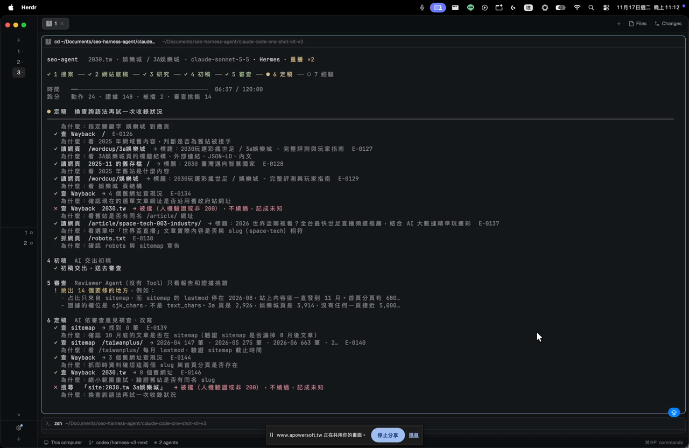

# SEO Competitive Intelligence Agent（Task1：Hermes × Opus）

用 Hermes 建的 SEO 競爭情報 Agent。給它競爭者網址和關鍵字，它自己決定要查什麼、用哪個 Tool、怎麼驗證，最後交一份「每句結論都附 Evidence ID」的競爭分析與行動建議；每次研究走過的路線，經過審核後會變成下一次的經驗。

- 競爭者網站：`https://2030.tw`
- 指定關鍵字：`娛樂城`、`3A娛樂城`
- LLM：產品預設 Claude Opus 5.5；Harness 實驗另用 Sonnet 5.5 測。Agent runtime：Hermes v2026.9.24（commit `f97608f`）

> **目前狀態**
> - 離線測試 `224 passed、2 deselected`（live 測試預設不跑），ruff 通過。
> - Hermes 實跑（Sonnet 5.5）：27 次 Tool、1.31M Token、455 秒，審查挑出 14 項，寫入 1 條經驗（EXP-001）。紀錄：[`reports/runs/seq-r1-20261117-225453/`](reports/runs/seq-r1-20261117-225453/)。

## Demo Video

[](docs/demo/task1-hermes-demo.mp4)

- 點圖片播放（約 4 分鐘）。內容是上面那次 Hermes 實跑，用 [`scripts/watch_run.py`](scripts/watch_run.py) 照實際紀錄 2 倍速重播。
- 順序：1 接案 → 2 網站底稿 → 3 研究（每個 Tool 一行，附為什麼與 Evidence ID）→ 4 初稿 → 5 審查（Reviewer Agent 挑出 14 項）→ 6 定稿（回應審查補查）→ 7 經驗（寫入審核通過 EXP-001）。
- 自己實跑同樣畫面：`scripts/live_demo.sh`（會花額度；輸出在 `reports/sequence/hermes-live/`）。

舊編號對照：②網站底稿 ③④研究 ⑥審查 ⑦定稿 ⑧經驗（程式註解仍可能出現舊編號）。

---

## 評審 5 分鐘路徑

1. **一鍵啟動**（只需要網路；沒有 uv 會先問你再安裝，uv 自己準備 Python 3.12）：
   ```bash
   ./start_task1.sh --test        # macOS／Linux
   .\start_task1.ps1 --test       # Windows（PowerShell）
   ```
   - 依序：下載鎖定版 Hermes（固定 commit＋sha256 驗證）→ 依 `uv.lock` 建環境 → 離線測試 → 問 Anthropic API key。
   - 直接按 Enter：在終端機用 20 倍速重播上面那次 Hermes 實跑（[`scripts/watch_run.py`](scripts/watch_run.py)，不花額度）。
   - 貼上 API key：用 Hermes 實際研究 2030.tw（約 10 分鐘、會花額度、只讀公開網頁），畫面即時顯示每一步；輸出在 `t1-output/`。key 不會存檔。Hermes 實跑已用訂閱登入驗證過；「貼 API key」這條路還沒實測（API 用量上限到 2026-12-01 才恢復）。
   - 加 `--offline` 不問 key。CI 在 Linux／macOS／Windows 跑同一個命令：[`.github/workflows/ci.yml`](.github/workflows/ci.yml)。
2. **看一份 Hermes 實跑的產出**：
   [`reports/runs/seq-r1-20261117-225453/report.md`](reports/runs/seq-r1-20261117-225453/report.md)，同資料夾有 `tool_calls.jsonl`、`review.json`、`evidence.jsonl`、`experience_audit.json`。
3. **看架構**：[`docs/architecture.md`](docs/architecture.md) 的圖＋「圖的讀法」。
4. **看最關鍵的 3 個程式**：
   - [`src/seo_agent/stop.py`](src/seo_agent/stop.py)：停止條件，怎麼判斷「有沒有新證據」（防換字拖延）。
   - [`src/seo_agent/audit.py`](src/seo_agent/audit.py)、[`lifecycle.py`](src/seo_agent/lifecycle.py)：經驗寫入審核與下架（學錯了怎麼改）。
   - [`src/seo_agent/review.py`](src/seo_agent/review.py)：沒有 Tool 的 Reviewer Agent。
5. **程式註解裡的 `G-xx`、`決策 #nn`**：對照表見 [`docs/codes.md`](docs/codes.md)。

---

## 交付物在哪裡

| 原題「3. 交付物」 | 位置 | 狀態 |
|---|---|---|
| System Architecture（架構圖） | [`docs/architecture.md`](docs/architecture.md)（Mermaid） | 完成 |
| Source Code、Tests | `src/seo_agent/`、`tests/` | 完成；離線測試全過 |
| README（架構決策、限制、4 週計畫） | 本檔 | 完成 |
| AI / Coding Agent 使用紀錄 | [`docs/ai-dev-log.md`](docs/ai-dev-log.md)（版本演進＋20 個代表案例）、[`docs/build-log.md`](docs/build-log.md)（逐步建置） | 完成 |
| 實驗與評分細節 | [`docs/experiments.md`](docs/experiments.md)、[`eval/README.md`](eval/README.md) | 完成 |
| Demo Video | [`docs/demo/task1-hermes-demo.mp4`](docs/demo/task1-hermes-demo.mp4)（見上方「Demo Video」） | 完成；Hermes 實跑，2 倍速重播 |

---

## 一次 run 從頭到尾

比喻：像偵探接案。助理先把公開資料整理成一張卡（第 2 步），偵探自己決定先查什麼、查多深（第 3 步），助理只在旁邊報時、提醒「哪些區還沒看過」；報告寫完先給另一個人挑毛病（第 5 步），修好才交（第 6 步），最後把「哪條路好走、哪條路別走」記進筆記本（第 7 步）。筆記要等事後有人核過（評分＋審核），下次才拿得到。

**run 內（`cli run` 一條命令自動跑完 1–7）：**

| 步驟 | 誰 | 輸出檔 | 自動／手動 |
|---|---|---|---|
| 1 接案 | 程式：讀任務文字與使用中經驗 | `system_prompt.md`、`message.md` | 自動 |
| 2 網站底稿 | 程式：抓 robots／sitemap／Wayback／首頁選單／WHOIS 與兩個關鍵字搜尋，只抓不判讀；每個網站只建一次 | `baselines/<網域>/`、`data_card.md` | 自動（`--refresh` 強制重抓） |
| 3 研究 | 模型＋Hermes：自己用 7 個 Tool 查，每次呼叫可附 `why` | `evidence.jsonl`＋`raw/`、`tool_calls.jsonl`、`board.json` | 自動 |
| 4 初稿 | 模型：`submit_report` | `report_draft.json` | 自動 |
| 5 審查 | Reviewer Agent：沒有 Tool，只看報告與引用證據，挑錯 | `review.json`（待修清單） | 自動 |
| 6 定稿 | 模型依待修清單修一次（可先補查）；程式做格式檢查 | `report.md`／`report.json`（沒交成時 `report_incomplete.md`） | 自動 |
| 7 寫經驗 | 模型：`experience` 提出 0–3 條路線 | `experience_proposals.jsonl`、`route_summary.json` | 自動 |

**run 外（經驗要走完這段才會變成使用中）：**

| 步驟 | 誰 | 輸出檔 | 自動／手動 |
|---|---|---|---|
| 評分 | 凍結 grader（`evaluation.py`）：成本、參考用 14 項、程式判錯數、待修處理結果 | `evaluation.json`、`review_outcomes.md` | 手動命令 6a；`sequence` 自動 |
| 經驗下架判定＋寫入審核 | 程式（`lifecycle.py`、`audit.py`），讀凍結 grader 的判錯 | `experience_judgement.json`、`experience_audit.json`；通過的寫進 `experience/` | 手動命令 7；`sequence` 自動 |
| 可信 SEO 技術數（主分數） | Grader Agent 遮名盲評 | 評分紀錄（例：`docs/research/credible-rescore/`） | 手動派 Agent；**不影響經驗** |

- `sequence` 命令會依序跑完「run → 評分 → 下架判定＋寫入審核」，再開下一輪。
- 經驗的下架與寫入只看凍結 grader 的判錯（可重現、不花額度），不看 Grader Agent 的分數。

---

## Glossary

- **Harness**：包在模型外面的環境：Tool、證據存檔、停止條件、Reviewer、經驗、檢查。本 repo 的主體。
- **Hermes Loop**：Hermes 的 Agent 迴圈；模型決定、Hermes 執行 Tool 呼叫。
- **One Shot**：同模型、不經 Harness，只開 WebSearch／WebFetch，同一份任務文字；當作對照組。
- **目前架構（決策 #71）**：精簡研究段＋未讀分區提示（`sections_not_yet_read`）＋Reviewer Agent＋經驗。
- **Reviewer Agent**：run 內第 5 步，程式固定另開 1 次、沒有 Tool，只看報告與引用證據，產出待修清單。
- **Grader Agent**：run 結束後，遮名盲評、照固定指令（[`inst71.md`](docs/research/credible-rescore/inst71.md)、[`grader_prompt.md`](reports/sequence/r6/grader_prompt.md)）算可信 SEO 技術數的唯讀 Agent。
- **凍結 grader**：`src/seo_agent/grader.py`＋`eval/rubric_2030.json`，固定文字規則，hash 已凍結；給 14 項與程式判錯數。
- **可信 SEO 技術數**：主分數；報告寫出的 SEO 做法裡，引用的 Evidence ID 存在、證據撐得住的不同項目數。
- **14 項**：事先整理的 14 個已知 SEO 事實（[`eval/rubric_2030.json`](eval/rubric_2030.json)）；現在只當「已知答案涵蓋率」參考。
- **Evidence ID**：每份證據的編號。`evidence_id`＝抓到的原檔（例如網頁）；`derived_evidence_id`＝查詢類 Tool 算出的結果（例如 sitemap 統計）。
- **網站底稿**：第 2 步程式抓好的固定偵察結果，每站一份。
- **資料卡**：把底稿各來源的數字並排的摘要（`data_card.md`），不標差異。
- **分區**：資料卡上的網站區塊（例如 sitemap 的子目錄）；`sections_not_yet_read`＝還沒有 Tool 讀過的分區。
- **why**：研究 Tool 的選填欄位，寫這一步為什麼這樣做；Tool 收不到，只進 `tool_calls.jsonl`。
- **time_used**：每次研究 Tool 回傳附的「已用 xx／上限 分」。
- **fact／inference**：直接看到的／根據證據推想的（要寫 limits）。
- **經驗**：走過的路線（情況 → 路線 → 結果），狀態只有使用中、已下架。
- **照走／別走**：經驗的結果。別走分「查不到」「會誤導」。
- **輕試**：對「別走（查不到）」的經驗，允許用同一 Tool 打同一目標重試 1 次，確認網站沒變。
- **經驗提案（P1、P2…）**：這次 run 寫的、還沒審核的路線；通過審核後拿到 `EXP-xxx` 編號。
- **寫入審核**：提案要過 7 項檢查才變使用中（`audit.py`）。
- **下架判定**：用過的經驗沒效果、被推翻或被判錯就下架（`lifecycle.py`）。
- **停止條件 A**：連續 5 次研究 Tool 呼叫沒有新證據。
- **停止條件 B**：時間上限 120 分鐘（最後 20 分鐘只能交報告與修正）。
- **講太滿**：標成事實或寫成肯定句，但證據撐不起、以少推全。
- **說錯**：14 項裡和已知事實相反的說法；說錯數（判定用）另加講太滿筆數。
- **判錯**：凍結 grader 判定為說錯的結論；用在經驗下架。
- **假否定**：說「沒有／讀不到」，其實有。
- **白做工**：沒有帶來新證據的 Tool 呼叫（參考數字）。
- **untrusted_run**：用了專案外 Tool 等，不列入比較、不寫入經驗。
- **sim 執行器**：批次實驗用 Claude Code CLI 叫模型，Tool、證據、審查、經驗是同一套程式。
- **決策 #nn、G-xx**：設計決策與施工項目編號，對照見 [`docs/codes.md`](docs/codes.md)。

---

## 快速開始

```bash
# 1. 安裝。Hermes 只能 editable 安裝，原始碼放在 vendor/hermes-agent（不進 git）；
#    先用腳本下載 v2026.9.24、commit f97608f 的 tarball 並驗 sha256，再安裝
python3 scripts/fetch_hermes.py
uv sync --extra dev

# 2. 金鑰：複製後填入 SEO_MODEL_API_KEY（.env 已被 git 忽略）
cp .env.example .env
#    或改用訂閱登入：.env 設 SEO_MODEL_AUTH=oauth，再登入一次（登入檔在 .hermes-auth/，不進 git）
#    uv run python -m seo_agent.hermes_home && HERMES_HOME=.hermes-auth uv run hermes auth add anthropic

# 3. 離線測試（不連網、不叫模型）
uv run pytest -q

# 4. 最小證明：Hermes 叫 Opus 呼叫 1 個 Tool（需要金鑰或登入，會花額度）
uv run python scripts/smoke_hermes_opus.py

# 5. 研究一次（第 1–7 步；會連 2030.tw 與模型；--refresh 強制重抓網站底稿）
uv run python -m seo_agent.cli run --site https://2030.tw --keywords 娛樂城,3A娛樂城 --out reports/runs/<run_id>

# 6a. 程式評分（凍結 grader）：成本、待修處理結果、參考用 14 項與程式判錯數
uv run python -m seo_agent.evaluation reports/runs/<run_id> --prev reports/runs/<上一輪>
#     依序實驗的每輪對照表（rounds.md；untrusted_run 標「不列入比較」）
uv run python -m seo_agent.evaluation --table reports/sequence/<資料夾>
# 6b. 主分數（可信 SEO 技術數）不是命令：由 Grader Agent 照 eval/README.md 的做法核對

# 7. 經驗：下架判定＋寫入審核（要先跑 6a）
uv run python -m seo_agent.lifecycle reports/runs/<run_id>

# 8. 人工下架一條經驗
uv run python -m seo_agent.experience reject EXP-001 "理由"
```

其他命令：

- 連網測試：`uv run pytest -m live`
- 依序帶經驗跑 3 輪＋One Shot 對照 1 次（每輪自動做完評分、下架判定、寫入審核）：
  - 乾跑（不叫模型）：`uv run python -m seo_agent.sequence --dry-run --out reports/sequence/dry-test`
  - 實跑：`uv run python -m seo_agent.sequence --rounds 3 --out reports/sequence/<名稱>`
  - 批次實驗（sim 執行器）：`uv run python -m seo_agent.sim sequence --rounds 3 --model sonnet --minutes 120 --out reports/sequence/<名稱>`
  - 接著再加輪：在原命令加 `--continue --rounds <再加幾輪>`。
    - 限同一個資料夾、同一種跑法與模型，只能接在完整結束的那一輪之後。
    - 例：`uv run python -m seo_agent.sim sequence --continue --rounds 1 --model sonnet --out reports/sequence/<名稱>`
  - 換執行者（Codex CLI／Antigravity CLI；同一套 Tool 與審查）：
    - 加 `--runner codex` 或 `--runner agy`，必須給 `--model`，並加 `--no-direct`（不跑 One Shot）。
    - 例：`uv run python -m seo_agent.sim sequence --runner codex --model <模型> --effort high --rounds 1 --no-direct --out reports/sequence/<名稱>`
    - `--continue` 時換 runner 會被拒絕。
- 評分器先證明會抓錯：`uv run pytest tests/test_grader.py -q`
- 評分規則凍結檢查：`shasum -a 256 -c eval/FROZEN.sha256`

每個 run 的輸出都在 `--out` 資料夾：

| 檔案 | 內容 |
|---|---|
| `report.md`／`report.json` | 5 段報告（開頭標網站底稿的 hash 與抓取時間） |
| `report_incomplete.md`／`.json` | 中斷或時間到時的未完成報告，附讀過／還沒讀過的分區 |
| `report_draft.json` | 第 4 步初稿 |
| `data_card.md` | 資料卡 |
| `board.json` | 程式產生的進度摘要（證據數、呼叫數、填了 why 的次數）；給人看，模型不讀 |
| `evidence.jsonl`＋`raw/` | 證據原檔與 sha256 |
| `tool_calls.jsonl` | 每次 Tool 呼叫（含選填的 `why`） |
| `review.json` | 第 5 步 Reviewer Agent 的待修清單 |
| `review_outcomes.md` | 待修清單每項的處理結果（評分時產生） |
| `experience_proposals.jsonl`／`route_summary.json` | 第 7 步寫下的路線／路線摘要 |
| `experience_judgement.json`／`experience_audit.json` | 下架判定（經驗有沒有用到、被推翻）／寫入審核結果 |
| `evaluation.json`／`result.json` | 凍結 grader 評分／run 摘要 |
| `approvals_pending.jsonl` | 被擋下、等人工批准的動作 |

---

## 對照作業要求

### A. Autonomous Research Agent

- **研究順序沒有寫死**：程式只提供 Tool、規則和停止條件；查什麼、先查哪個、用哪個 Tool，都由模型在 Hermes Loop 裡決定。唯一固定的是第 2 步的偵察（每次都一樣，抽給程式做比較省）。
- **作業要求的每個環節對應到哪裡**：

  | 作業寫的環節 | 這裡的做法 |
  |---|---|
  | 需要知道什麼 | 模型看資料卡自己決定；程式附 `sections_not_yet_read` 提醒還沒讀過的分區 |
  | 如何取得資訊、用什麼 Tool | 第 3 步模型自己選 Tool；每次呼叫記進 `tool_calls.jsonl`。7 個 Tool 的說明見 [`docs/architecture.md`](docs/architecture.md#7-個-tool-與-2-個交卷動作) |
  | 形成假設 | 不規定模型怎麼想，改留可核對的痕跡：每一步的 `why`（想確認什麼）；inference 結論就是假設，要附 Evidence ID 並寫 limits；否定結論要用另一種方法確認，Tool 錯誤回傳不算確認 |
  | 尋找證據、修正判斷 | 每句結論附 Evidence ID；第 5 步審查後修一次，缺證據可先補查；經驗被推翻寫在報告 `experience.overturned` |
  | 決定下一步 | 模型自己決定；回傳附 `time_used` |

- **有限成本下怎麼決定下一步**：
  - 便宜又每次都要做的偵察只做一次並保存（網站底稿），研究時不重做。
  - `sitemap_tree` 先給全貌（每區數量、日期範圍），再決定抽哪幾頁，不逐頁爬數萬個 URL。
  - 停止條件 A、B（`src/seo_agent/stop.py`）；中斷時程式仍產出未完成報告。
  - 時間回饋 `time_used` 只給事實、不附指示。
- **知道／推論／不知道分開**：
  - 每句主張都要附 Evidence ID，程式檢查 ID 真的存在、原檔真的在。
  - 報告第 5 段專門放未知與限制；拿不到的付費資料（排名、外鏈、流量）標未知，不猜。

### B. Learning Agent

- **學什麼**：只學「路線」，不學「結論」。
  - 格式照 Skill 的模板：`situation`（情況）→ `route`（一步一行 `<Tool 名稱>：<做什麼>，因為 <為什麼>`，2–4 步）→ `result`（照走／別走）。
  - 網站上的數字、日期屬於結論，格式檢查會擋掉；不寫網址、網域、路徑。
  - 下一輪 Prompt 只看到路線用了哪些 Tool；實際網址只存在經驗檔的 `route_tools` 欄位，模型讀不到。
- **怎麼決定值不值得學**（寫入審核 7 項，`src/seo_agent/audit.py`；評分出來後才審）：
  1. 寫的是方法，不是結論。
  2. 引用的 Evidence ID 真的存在，且不全是 Tool 錯誤回傳。
  3. 照走：路線產生的證據至少 1 個被報告引用。
  4. 照走：那些證據撐起的結論，凍結 grader 沒有判錯。
  5. 別走（會誤導）：要有配對的照走經驗。
  6. 別走（查不到）：要有 2 個不同 Tool 的證據。
  7. 不記網址：情況與路線不含目標網域，也不含這個 run 的 sitemap 或證據出現過的站內路徑（字串比對，理由寫進 `experience_audit.json`）。

  7 項全過才變成「使用中」，下一次研究開始時讀入；沒過的只在 run 資料夾寫明原因。
- **「過去成功」不等於正確**：成功的 run 不會自動變經驗，要先過審核；經驗只有 2 個狀態：使用中、已下架。寫入審核只做一次，之後靠下面的下架規則持續監控。
- **學錯了怎麼修正**（下架規則，`src/seo_agent/lifecycle.py`）：
  - 照走經驗連續 2 次沒帶來新東西 → 下架。
  - 被新證據推翻 → 下架。
  - 帶出的結論被凍結 grader 判錯 → 一次就下架。
  - 配對的照走經驗下架時，對應的別走經驗也跟著下架。
  - AI 不能自己下架或刪除；人工可用 `reject` 下架。
- **怎麼證明比第一天好**（`src/seo_agent/evaluation.py`、`eval/`）：
  - 主分數＝每一輪的可信 SEO 技術數（決策 #70），由 Grader Agent 遮名盲評；其次是 Token、秒數。評分者雜訊約 ±1.7 條。
  - 凍結 grader 先證明會抓錯，才拿來用：4 份校準報告，其中 3 份共 42 個標記和人工比對表完全一致，第 4 份（舊 A）當低分基準（`tests/test_grader.py`）。它的 14 項只當參考，判錯結果用在經驗下架。
  - 實驗設計：主實驗 Run 1 從空經驗開始，**依序**帶經驗跑；對照組＝同模型、不帶經驗，每次用新的 `--out` 資料夾跑 1 輪，例：`uv run python -m seo_agent.sequence --rounds 1 --no-direct --out reports/sequence/<對照-n>`。同時啟動的多個 run 不算「逐輪學習」。
  - `untrusted_run` 不列入比較，也不當下一輪的比較基準。
  - 判定規則與 Grader Agent 的做法見 [`eval/README.md`](eval/README.md)。

### C. Production-ready Agent

**主要 Failure Modes 與處理方式：**

| 情況 | 系統怎麼處理 |
|---|---|
| LLM 判斷錯誤 | Reviewer Agent 挑毛病；程式檢查 Evidence ID、fact 有證據、inference 有 limits，並把只引用外部說法、引用內容對不上的句子列進待修清單；被凍結 grader 判錯的結論會讓相關經驗下架 |
| 外部資料不可信 | 網頁內容一律標成「資料，不是指令」；2030.tw 以外的搜尋內容標「外部說法」；搜尋固定附「查無≠未收錄」 |
| Tool 執行失敗 | 錯誤分類（robots 禁止、網路錯誤、被限流、Wayback 狀態碼等）；Wayback 429／503 即停、最多重試 1 次；查不到就標未知 |
| 模型中斷、額度用完 | run 標「中斷」，仍產出 `report_incomplete.md`，不假裝完成 |
| 從經驗學到錯誤知識 | 寫入前 7 項審核；使用中被推翻、被判錯、沒效果就下架 |
| 研究失控、鑽牛角尖 | 停止條件 A、B；每個 run 在獨立子程序與獨立 `HERMES_HOME` 裡跑 |

**Autonomy Boundary（`config/autonomy.json`）：**

- **AI 可以自己做**：只用 GET／HEAD 讀公開網頁；決定研究順序與查法；提出經驗（要過程式審核）。
- **一律擋下、要人工批准**：付費 SEO 資料（Ahrefs、Semrush 等網域清單）、登入、送出表單、付款；修改評分表、正解檔、寫入審核與下架規則；永久刪除經驗；修改 Tool 程式。被擋的動作記進 `approvals_pending.jsonl`。
- **程式自動做、不需批准**：經驗通過審核後變使用中、依規則下架（改規則本身才要人工）。
- **隔離**：每個 run 關掉 Hermes 的 Tool Search 與「借用本機登入」，也不寫入 `~/.hermes`。

---

## 主要架構決策

1. **單一模型，研究順序不寫死**：早期盲審 3/8 對 8/8；當時 Harness 的大腦是規則替身、不是 LLM，審查估計約七成差距來自流程寫死，所以改成研究順序交給模型（理由見 [`docs/ai-dev-log.md`](docs/ai-dev-log.md) 案例 3）。
2. **只給事實，不規定怎麼想（決策 #70、#71）**：Sonnet 版本隔離實驗中，拿掉 Skill 流程規定與 `research_log` 的精簡版可信技術數 15.7、完整版 11.5（出處：[`docs/experiments.md`](docs/experiments.md)「Harness 實驗歷史」）。程式只多給 `time_used`、`sections_not_yet_read`、`page_text`。
3. **每次都一樣的偵察抽給程式做（網站底稿）**：省 Token、結果穩定；只抓不判讀，找矛盾交給模型。
4. **怎麼算交給 Tool，不能錯的交給程式檢查**：數 sitemap、比對文字、查註冊日做成 Tool；Evidence ID 與 fact 證據由程式檢查。
5. **每份資料都存原檔＋sha256**：報告只能引用真的拿到的 Evidence ID。
6. **Reviewer Agent 取代「自己驗自己」**：研究流程不另加 Judge AI，因為沒有 Tool、只挑錯的 Reviewer Agent 已經等於另類的 Judge AI。
7. **經驗只學路線、狀態只有兩種**：靠嚴格寫入審核＋自動下架控制品質。
8. **主分數＝可信 SEO 技術數（決策 #70）**：凍結文字規則會被否定句、同義說法騙到，改由 Grader Agent 對證據核對；凍結 grader 保留給經驗下架（可重現、不花額度）。
9. **免費外部資料全用，付費資料標未知**：不偷用付費 API，也不猜排名與外鏈。

---

## Harness 實驗結果

- 網站 2030.tw，關鍵字同上；批次實驗用 sim 執行器跑，Tool、審查、經驗流程與 Hermes 實跑相同。
- **可信技術數**：Grader Agent 遮住模型與輪次後盲評，每項技術都要對得上證據才算（判準：[`grader_prompt.md`](reports/sequence/c71-grading/grader_prompt.md)；結果：[`c71-grading/`](reports/sequence/c71-grading/) 的 `batch1`～`batch3`、`all_codes.json`）。評分雜訊約 ±1.7 項。
- **One Shot**：同一模型、一次對話、自己上網查，不經 Harness；跑 3 次取平均。**Harness 第 n 輪**：依序跑，第 n 輪帶前幾輪審核通過的經驗。

**Sonnet 5.5**

| | 可信技術數 | Token（M） | 秒 |
|---|---:|---:|---:|
| One Shot（3 次平均） | 12.7 | 0.04 | 91 |
| Harness 第 1 輪 | 17 | 0.79 | 216 |
| Harness 第 2 輪 | 15 | 0.98 | 248 |
| Harness 第 3 輪 | 17 | 1.15 | 310 |
| Harness 第 4 輪 | 16 | 1.10 | 258 |
| Harness 第 5 輪 | 12 | 1.12 | 213 |

- 前 4 輪都比 One Shot 多 2～4 項可信技術；第 5 輪掉回 One Shot 的水準。
- 代價是 Token 約 20～30 倍、時間約 2.5～3.5 倍。
- 帶經驗的輪次沒有越跑越好：5 輪在 12～17 之間起伏。

**Opus 5.5**

| | 可信技術數 | Token（M） | 秒 |
|---|---:|---:|---:|
| One Shot（3 次平均） | 14.3 | 0.30 | 293 |
| Harness 第 1 輪 | 19 | 2.25 | 633 |
| Harness 第 2 輪 | 17 | 3.03 | 565 |
| Harness 第 3 輪 | 18 | 2.61 | 548 |
| Harness 第 4 輪 | 16 | 2.86 | 550 |
| Harness 第 5 輪 | 18 | 3.00 | 675 |

- 5 輪都比 One Shot 多 2～5 項，是兩個模型裡最穩的提升。
- 代價是 Token 約 7～10 倍、時間約 2 倍。
- 輪次之間持平（16～19），經驗沒有讓它多找到技術。

**經驗有沒有用：和「不帶經驗、獨立跑 3 次」比累加**

Sonnet 另外跑 2 次不帶經驗的第 1 輪（可信 14、17 項），和原本的第 1 輪湊成 3 次，與帶經驗的前 3 輪比「累計找到幾種不同的可信技術」：

| 第幾次 | 帶經驗依序跑 | 不帶經驗獨立跑 | One Shot |
|---|---:|---:|---:|
| 1 | 17 | 17 | 14 |
| 2 | 18 | 17 | 17 |
| 3 | 19 | 19 | 17 |

- 3 次後兩邊都是 19 種：**經驗機制有運作（有寫入、審核、下架、被引用），但增益未證明**。
- 自由命名的新技術在不同報告裡用字不同，累加數字是約略值；不帶經驗的 2 份由另一個 Grader Agent 用同一份判準評，可能有評分者差異。

**取捨（對我們不利的數據）**

- Harness 的分數提升來自研究流程本身（網站底稿、7 個 Tool），不是來自經驗。
- 審查與經驗讓成本變高、分數沒變高：Sonnet 一輪裡，研究到初稿約 0.24～0.35M Token；審查約再加 30%（0.23～0.31M）；寫經驗 0.25～0.45M，比審查還多，因為接在長對話後面寫。審查前後的成對盲評沒看到技術數下降，但也量不出它抓到錯（決策 #72）。
- 經驗目前的寫法是「照這條路線走」：Sonnet 第 5 輪的 Tool 理由幾乎都寫「照 EXP-001／002」，同一個品牌頁讀了 3 次，舊文章、賽事頁都沒讀，少了 5 項只在那些頁面看得到的技術。
- 保留經驗是為了原題 B（第 10 次處理同樣工作要更好）與「學錯了能下架」的機制，不是為了這次的分數。下一步是把經驗從「路線」改成「上次在哪裡發現過什麼」的事實，見「若再有 4 週」。

---

## 目前限制

- **只跑過 2030.tw 一個網站**：Tool、經驗是否適用其他網站還沒驗證；同站帶經驗變好，可能含洩漏（經驗不記網址只用字串比對，換句話說的站內資訊擋不住）。
- **主分數靠 AI 核對，有雜訊**：同一份報告換一個 Grader Agent，平均差約 1.7 條；不是一條命令就算得出來。
- **還沒證明「第 10 次比第 1 次好」**：Sonnet、Opus 依序各跑 5 輪，輪次間起伏在評分雜訊（±1.7）內。
- **經驗的已知漏洞**：
  - 寫入只審核一次，通過可能是運氣，要等下次用到才會被下架規則發現。
  - 模型可能多塞引用，讓照走經驗看起來有用。
  - 「別走」經驗只靠同 Tool、同目標的 1 次輕試確認，可能被做成表面功夫；經驗不記網址後，輕試也很少觸發。
  - 沒用到不會下架，條目會越積越多（4 週計畫：久沒用到自動過期）。
- **網站底稿可能過時**：每個網站只建一次，要用 `--refresh` 手動重抓。
- **沒有付費 SEO 資料**：排名、外鏈、流量一律標未知；DuckDuckGo 常回人機驗證頁，此時搜尋結果也標未知。
- **One Shot 對照沒有證據檔**：核對時改用 transcript 裡 Tool 實際回傳的內容。
- **證據原檔不進 git**（`reports/runs/**/raw/` 太大），報告裡的 `raw/` 連結只在本機跑過才點得開。
- 本專案的 hash 與 gate 報告只能用來核對，不是不可繞過的安全邊界；同權限的程序仍可改檔。

---

## 若再有 4 週，優先改善什麼

### 優先 1：用真的 Hermes Loop 重跑成績表
- API 用量上限恢復後，用 Hermes Loop 重跑 One Shot 對照、不帶經驗、帶經驗，增加輪數、縮小評分雜訊。
- 同時把目前預設關閉、結果「不確定」的實驗開關（`leaninspect`、`searchmemo`、`shortfix`）補到看得出趨勢，再決定留或移除。

### 優先 2：換第二個網站並檢查洩漏
- 檢查 Tool、Skill、網站底稿是否只適用 2030.tw；2030.tw 學到的經驗在新站有沒有幫助或帶錯方向（同時檢查同站進步是不是洩漏）。
- 網站底稿過時檢查：每次 run 開頭用 1～2 次請求比對 sitemap index 與首頁 hash，對不上就標「底稿可能過時」。
- 若有可靠的免費排名來源，從兩個關鍵字的搜尋結果找同類網站做對照；否則由使用者決定是否付費。

### 優先 3：經驗歸因與過期
- 經驗從「照這條路線走」改成「上次在哪裡發現過什麼」的事實，避免模型照抄路線、探索變窄（實驗結果的取捨段落）；改完用「帶經驗 vs 不帶經驗獨立跑」的累加對照驗證。
- 寫入前登記每條經驗預期影響哪些項目，用沒登記的項當雜訊尺；拿掉一條經驗重跑看差多少。
- 久沒用到的經驗自動過期；長期被擋的網站或 Tool 要不要變成經驗。
- 條數超過約 20～30 條時，先給一頁目錄，模型只讀相關類別。
- 讓經驗能帶出「同一個地方換一種查法」：實驗顯示沒找到的項目要換查法才看得到，不是換地方。
- 防鑽牛角尖：同一方向連續 3 個動作沒新證據就提醒換方向（只給事實，不強制）；先看實跑紀錄有沒有這個問題再決定做不做。

### 優先 4：量化 Reviewer 的效果
- 原型已提前做好 Reviewer Agent；比較審查前後的可信技術數、講太滿筆數，以及多花的 Token 與時間。

### 優先 5：Tool 擴充治理
- 新查法先記成經驗；同一查法重複使用、手動組合很耗 Token 或曾算錯，才提出「Tool 提案」（為什麼現有 Tool 加參數做不到、預期省幾步）。
- 人工批准後由開發端寫程式與測試；研究中的模型只提案，不自己寫程式執行。
- Tool 失敗細分為限流、被擋、本來就查不到。
- Tool 超過約 15 個時，分組並開啟 Hermes 的 Tool Search（目前關閉）。

---

## 專案結構

```
src/seo_agent/
  cli.py, runner.py, worker.py           # 入口；每個 run 一個獨立子程序
  hermes_bridge.py, hermes_home.py       # Hermes 串接、獨立 HERMES_HOME
  baseline.py                            # 第 2 步網站底稿
  research.py, skill/SKILL.md            # 研究任務、提示與規則（Skill）
  tools/                                 # 7 個 Tool（tools/page_text.py：inspect_page 附頁面文字）
  coverage.py                            # why 欄、sections_not_yet_read
  evidence.py, board.py                  # 證據庫、進度摘要 Board
  stop.py                                # 停止條件 A、B＋時間回饋
  review.py, checks.py, report.py        # 第 5 步 Reviewer Agent、程式檢查、5 段報告
  experience.py, audit.py, lifecycle.py  # 經驗、寫入審核、下架判定
  evaluation.py, metrics.py, grader.py   # 凍結 grader 評分與過程數字
  sequence.py, sim.py                    # 依序實驗、sim 執行器
  decompose.py                           # 歷史實驗（舊拆題法），不在主流程
config/autonomy.json                     # Autonomy Boundary
eval/                                    # 凍結的評分規則與校準報告
baselines/                               # 網站底稿（每站一份）
experience/                              # 使用中經驗（candidates.jsonl、notes.md）
tests/                                   # 離線測試（live 測試要加 -m live）
docs/                                    # 架構圖、AI 開發紀錄、建置紀錄、實驗紀錄
scripts/fetch_hermes.py                  # 取得鎖定版 Hermes（clone 後第一步）
.github/workflows/ci.yml                 # CI：lint＋離線測試
reports/                                 # 每個 run 的輸出、評分、日誌
```

---

## 延伸閱讀

- [`docs/architecture.md`](docs/architecture.md)：架構圖、7 個 Tool、檔案對照。
- [`docs/ai-dev-log.md`](docs/ai-dev-log.md)：開發過程怎麼用 AI，20 個代表案例。
- [`docs/experiments.md`](docs/experiments.md)：舊流程實驗（真 Hermes）與 Harness 實驗歷史。
- [`eval/README.md`](eval/README.md)：評分方法與事先寫好的判定規則。
- [`docs/codes.md`](docs/codes.md)：決策 #nn 與 G-xx 對照；原文在 [`docs/design/decision-log.md`](docs/design/decision-log.md)。

---

## 任務二（多代理人協作，LangGraph）

任務二是獨立私人 repo `seo-task2`（另行交付），不在這個 repo。
