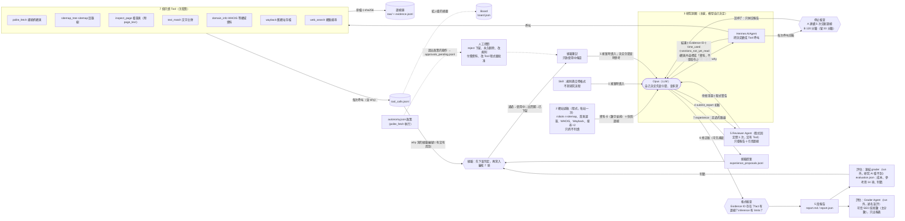

# 系統架構（目前架構，決策 #71）

對應原題「3. 交付物：System Architecture」：Hermes、LLM、Skills / Tools、Data、Memory / Learning、Evaluation 的主要關係。

步驟編號和 README「一次 run 從頭到尾」相同（舊編號對照：②網站底稿 ③④研究 ⑥審查 ⑦定稿 ⑧經驗）。

## 一句話
程式先做一次固定偵察（網站底稿），之後模型自己決定查什麼、查多深；程式只多給事實（時間、還沒讀過的分區、頁面文字），不規定怎麼查。初稿固定經過一次 Reviewer Agent 審查、修一次，交 5 段報告，再寫下走過的路線。run 結束後，凍結 grader 評分，程式依結果做經驗下架判定與寫入審核；主分數另由 Grader Agent 盲評。

- **Reviewer Agent**：run 內第 5 步，程式固定另開 1 次、沒有 Tool，只看報告與引用證據，產出待修清單。
- **Grader Agent**：run 結束後，遮名盲評、照固定指令算可信 SEO 技術數；只出報表，不影響經驗。

## 圖

## 圖的讀法
- **第 2 步 網站底稿**：每次都一樣的偵察抽出來由程式做，每個網站只建一次（`--refresh` 重抓）。資料卡只把數字並排，不標差異；差異交給模型找。
- **主線（第 3 步）**：模型和 Hermes 來回，模型決定、Hermes 執行，研究順序沒有寫死，Skill 也不寫研究流程。
  - 程式只多給三樣事實：`time_used`（已用時間）、`sections_not_yet_read`（資料卡分區裡還沒有 Tool 讀過的，只看呼叫參數裡的網址）、`inspect_page` 附 `page_text`（扣掉和首頁相同段落後的頁面文字）。
  - 每個研究 Tool 多一個選填 `why`：這一步為什麼這樣做。Tool 本身收不到這欄，只進 `tool_calls.jsonl`；照經驗查時寫經驗編號，程式據此判定經驗有沒有用到。
- **Board**：程式從 Tool 呼叫紀錄產生的進度摘要（證據數、呼叫數、填了 why 的次數），給人看；模型不讀，`result.json` 的 `why_filled` 取自它。
- **第 5 步 Reviewer Agent**：程式在初稿後固定開 1 個沒有 Tool 的審查 Agent，只看報告和引用的證據原文；模型依待修清單修一次（第 6 步），缺證據可先用研究 Tool 補查。它已等於另類的 Judge AI，所以不另加 Judge AI。
- **評估分兩框，都在 run 外**：
  - 凍結 grader（`eval/` 已凍結）：產出 `evaluation.json`；14 項只當參考，判錯結果餵給經驗下架判定。
  - Grader Agent：照固定指令算可信 SEO 技術數（主分數，決策 #70），只出報表，不影響經驗。
  - 研究程式和 Tool 說明都讀不到這些評分規則。
- **經驗**只有 2 個狀態：使用中、已下架。評分出來後，程式**先**判定這次讀入的經驗要不要下架（用到＝why 寫了編號的那次呼叫用的是路線上的 Tool；推翻＝報告 `experience.overturned` 附證據庫裡真的有的 Evidence ID），**再**審核第 7 步的提案，7 項全過才變成使用中。AI 不能自己下架。`sequence` 命令會自動做完這段；單跑 `cli run` 時要手動跑 `evaluation`、`lifecycle`。
- **人工把關**：Tool 本身沒有送出、登入、付款的能力；`polite_fetch` 依 `config/autonomy.json` 擋下付費或登入主機、非 GET／HEAD 方法，記進 `approvals_pending.jsonl` 等人工批准。`reject` 下架與永久刪除、改規則、改 Tool 程式也都要人工。

## 7 個 Tool 與 2 個交卷動作
| Tool | 做什麼 |
|---|---|
| polite_fetch（禮貌抓網頁） | robots 判斷、同主機共用間隔、記錄轉址鏈、狀態碼、標頭；原檔存檔＋Evidence ID＋hash |
| sitemap_tree（sitemap 目錄樹） | 一次讀完全部 sitemap 存 SQLite；回傳每區數量／佔比／日期範圍，另有展開、搜尋網址、按月、抽樣、比對 5 種查詢 |
| inspect_page（看單頁） | title、description、canonical、robots、H1–H4、JSON-LD 類型、內外鏈（位置：選單／正文／頁尾）、追蹤碼；預設附 page_text |
| text_match（文字比對） | 原樣與寬鬆（大小寫、全半形、URL 編碼）次數分開列，附找到的寫法與搜尋範圍 |
| domain_info（WHOIS 等網域資料） | WHOIS／RDAP 註冊日、註冊商、DNS |
| wayback（舊網址存檔） | Wayback 快照時間軸、舊網址清單、舊網址現況；429／503 即停，最多重試 1 次 |
| web_search（網路搜尋） | 免費來源，結果存檔，固定附「查無≠未收錄」；2030.tw 以外的網站內容標「外部說法」 |

- 交卷動作：`submit_report`（第 4、6 步交報告）、`experience`（第 7 步寫路線）。不能拿來查資料，不算研究 Tool，也不算進停止條件 A。

## 檔案對照
| 圖上 | 檔案 |
|---|---|
| Hermes 串接 | `src/seo_agent/hermes_bridge.py`、`hermes_home.py`、`runner.py`、`worker.py`、`cli.py` |
| 第 1 步 研究任務與提示 | `src/seo_agent/research.py`、`skill/SKILL.md` |
| 第 2 步 網站底稿 | `src/seo_agent/baseline.py`（存在 `baselines/<網域>/`） |
| Tool | `src/seo_agent/tools/*.py` |
| why、sections_not_yet_read、page_text | `src/seo_agent/coverage.py`、`tools/page_text.py` |
| 證據庫 | `src/seo_agent/evidence.py` |
| Board | `src/seo_agent/board.py` |
| 停止檢查 | `src/seo_agent/stop.py` |
| 第 5 步 Reviewer Agent | `src/seo_agent/review.py`、`checks.py` |
| 第 6 步 格式檢查與 5 段報告 | `src/seo_agent/report.py` |
| 經驗筆記 | `src/seo_agent/experience.py`（存在 `experience/`） |
| 評估：凍結 grader | `src/seo_agent/evaluation.py`、`metrics.py`、`eval/rubric_2030.json`、`src/seo_agent/grader.py` |
| 評估：Grader Agent | 固定指令 `docs/research/credible-rescore/inst71.md`、`reports/sequence/r6/grader_prompt.md`；重算腳本 `docs/research/credible-rescore/rescore.py` |
| 下架判定、寫入審核 | `src/seo_agent/lifecycle.py`、`audit.py` |
| 依序實驗 | `src/seo_agent/sequence.py`（依序跑＋每輪評分、下架判定、寫入審核）、`sim.py`（sim 執行器） |
| 歷史實驗，不在主流程 | `src/seo_agent/decompose.py`（舊拆題法比較） |
| 自主邊界設定 | `config/autonomy.json`（由 `src/seo_agent/tools/fetcher.py` 執行） |
